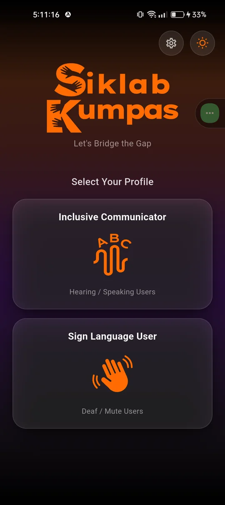
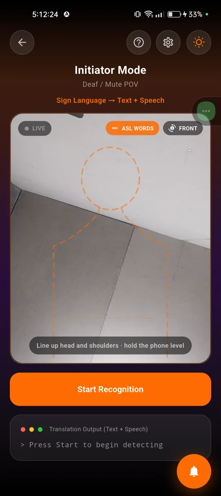
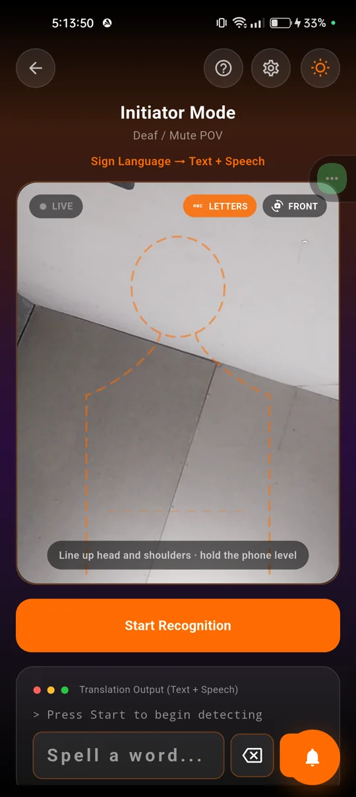
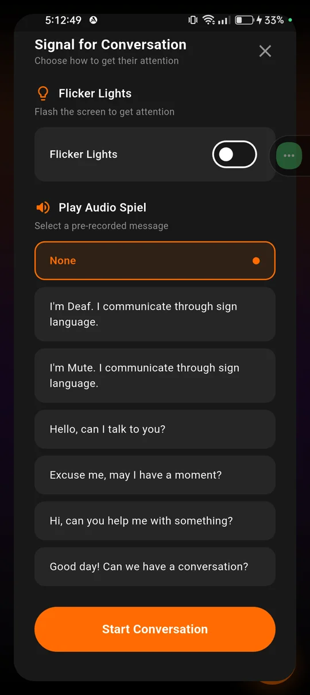
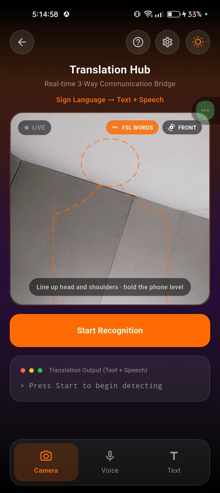
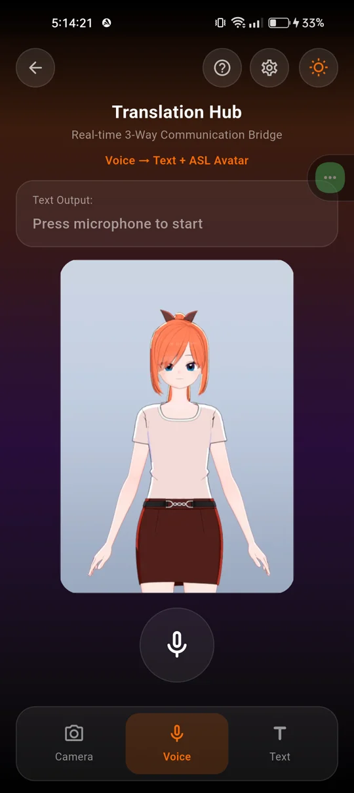
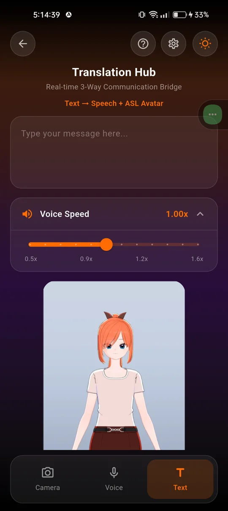
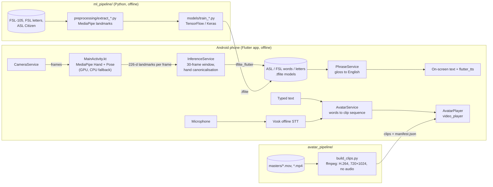

# Siklab-Kumpas

Siklab-Kumpas is an Android app for conversations between Deaf or mute signers and hearing people. Point the phone's camera at a signer and the app turns their signs into text and speech. Speak or type a reply and a 3D avatar signs it back. Recognition, speech-to-text and text-to-speech all run on the phone, and the app requests no internet permission.

The app recognises Filipino Sign Language (FSL) words and letters and American Sign Language (ASL) words. The avatar signs in ASL.

*Siklab* means a spark; *kumpas* means a gesture of the hand.

**Status:** v1.0.0, released September 2026. [Download the APK](https://github.com/Dan-sama1/siklab-kumpas-web/releases/latest/download/siklab-kumpas.apk) · [Website and user manual](https://siklab-kumpas-web.vercel.app)

## App screenshots

<table>
  <tr>
    <td align="center"><br><sub>Home: pick a profile</sub></td>
    <td align="center"><br><sub>Initiator Mode, ASL words</sub></td>
    <td align="center"><br><sub>Fingerspelling (FSL letters)</sub></td>
    <td align="center"><br><sub>Signal for attention</sub></td>
  </tr>
  <tr>
    <td align="center"><br><sub>Translation Hub, FSL words</sub></td>
    <td align="center"><br><sub>Voice to text and avatar</sub></td>
    <td align="center"><br><sub>Text to speech and avatar</sub></td>
    <td></td>
  </tr>
</table>

## Core features (v1.0.0)

**Sign to text and speech**
- Three recognition modes, switched with the mode chip on the camera view:

  | Mode | Vocabulary | Shipped model |
  |---|---|---|
  | ASL words (default) | 56 words | `asl_demo50.tflite` |
  | FSL words | 105 words | `fsl105_v2canon.tflite` |
  | Letters (FSL fingerspelling) | A–Z | `fsl_letters_canon.tflite` |

- The app joins consecutive signs into a phrase and speaks it. A rule-based gloss converter (`phrase_service.dart`) adds the words ASL leaves out, so `HELLO GOOD MORNING` comes out as "Hello, good morning".
- Letters mode builds a word from fingerspelled letters, with a backspace button.
- A head-and-shoulders framing guide shows where the signer should sit. You can switch between the front and back cameras.

**Speech and text to avatar**
- Voice tab: offline speech recognition through Vosk (`vosk-model-small-en-us-0.15`, English). Your words appear as you speak, then the avatar signs them.
- Text tab: type a sentence; the phone speaks it through the device TTS engine (0.5×–1.6× speed) while the avatar signs it.
- The avatar plays pre-rendered ASL clips: 112 words plus 26 letters. It fingerspells any word it has no clip for and drops function words ASL does not sign ("is", "the").

**Around the conversation**
- Two profiles: *Sign Language User* (Initiator Mode, camera only) and *Inclusive Communicator* (Translation Hub with Camera, Voice and Text tabs).
- Signal for Conversation: flash the camera light and play one of six pre-written spoken openers, such as "I'm Deaf. I communicate through sign language."
- English and Filipino interface, light and dark themes, and an onboarding tour that runs on first visit to each screen and replays from the (?) button.

## System architecture



Each frame becomes a 226-value vector: 63 per hand (21 landmarks × xyz) and 100 for pose (25 landmarks × xyzv). The word models read 30 of these frames. The letters model reads a single frame. `features_v3.dart` reproduces `features_v3.py` for the ASL model, and `test/features_v3_test.dart` checks the two against a golden file.

### Models

| Model | Architecture | Training data |
|---|---|---|
| ASL words | Separable 1D convolutions + shallow Transformer encoder (`train_v3.py`), then fine-tuned to one demonstrator (`finetune_signer.py`) | ASL Citizen + on-device captures |
| FSL words | LSTM(128) → LSTM(64) → Dense, with landmark augmentation (`train_fsl105_v2_aug.py --canon`) | FSL-105 |
| FSL letters | Dense MLP 256 → 128 → 64 on one frame (`train_fsl_letters_canon.py`) | FSL letters dataset |

### Evaluation

The figures come from the training scripts and logs in this repo. Read the right-hand column before comparing them.

| Model | Figure | What it measures |
|---|---|---|
| FSL words | 97.19% held-out | Random split of FSL-105, which has one signer. The same person appears in training and test, so this does not measure accuracy on other signers (see `docs/FSL_RECORDING.md`). |
| FSL letters | 98.62% held-out | Held-out split of the FSL letters dataset. |
| ASL words | 90.54% on the ASL Citizen test set (687 clips) | Signers not seen in training, at corpus framing and 30 frames per sign. |
| ASL words | 95.95% on 74 held-out device clips (28 words) | Clips from the demonstrator the model was adapted to. For anyone else, use the 90.54% figure. |

The phone captures about five distinct frames per sign and frames the signer differently from the datasets. Both effects cost accuracy. [`docs/EVALUATION.md`](docs/EVALUATION.md) measures them on the 200- and 525-word ASL models.

## Tech stack

| Layer | Tools |
|---|---|
| App | Flutter 3.38 / Dart 3.10, Android (minSdk 24, targetSdk 35) |
| Flutter packages | `camera`, `tflite_flutter`, `vosk_flutter_service`, `flutter_tts`, `video_player`, `permission_handler`, `torch_light`, `flutter_svg` |
| Native (Kotlin) | MediaPipe Tasks Vision 0.10.0: `HandLandmarker`, `PoseLandmarker` (`pose_landmarker_full`), bridged over the `com.siklabkumpas/inference` method channel |
| ML pipeline | Python, TensorFlow / Keras, TFLite converter, MediaPipe, NumPy, scikit-learn, OpenCV, PyAV, Matplotlib |
| Avatar | Clips rendered outside this repo, transcoded with ffmpeg by `avatar_pipeline/build_clips.py` |
| Evaluation only | Google Gemini API (`ml_pipeline/eval/gemini_asl_probe.py`). The app does not use it. |

## Repository structure

```
Siklab-kumpas/
├── flutter_app/              Flutter app (the shipped product)
│   ├── lib/
│   │   ├── screens/          home, Initiator Mode (deaf_mute), Translation Hub (hearing_user)
│   │   ├── services/         camera, inference, features_v3, phrase, speech, offline speech, avatar, trace
│   │   ├── widgets/          recognition view, avatar player, framing guide, skeleton overlay, onboarding tour
│   │   └── theme/            design tokens
│   ├── android/              MainActivity.kt: MediaPipe bridge
│   ├── assets/               .tflite + MediaPipe .task models, labels, avatar clips, Vosk model
│   └── test/                 unit and widget tests
├── ml_pipeline/
│   ├── preprocessing/        landmark extraction, hand canonicalisation, v3 features
│   ├── models/               training, fine-tuning, TFLite conversion, cross-validation
│   ├── eval/                 frame-rate, framing, segmentation and device-condition probes
│   └── data/                 datasets and extracted tensors (gitignored)
├── avatar_pipeline/          build_clips.py: avatar masters to app-ready clips
├── avatar/                   mocap format contract and prompts for the external Blender work
├── design/ui_v2/             UI mockups, icons, wordmark
├── docs/                     evaluation, avatar, device setup, recording notes, user manual
├── assets/screens/           README screenshots
└── logs/                     training logs
```

## Getting started

### Flutter app

Requirements: Flutter 3.38 or newer and an Android phone with USB debugging. MediaPipe runs in `MainActivity.kt`, so recognition works on Android only. The three `.tflite` models the app loads are committed; you do not need to train anything to run it.

```bash
cd flutter_app
flutter pub get
flutter test                  # unit and widget tests
flutter run                   # debug build on a connected phone
flutter build apk --release   # release APK
```

Speech output uses the phone's TTS engine. If nothing is spoken, see [`docs/DEVICE_SETUP.md`](docs/DEVICE_SETUP.md).

### ML pipeline

There is no pinned requirements file. Install the packages the scripts import:

```bash
pip install tensorflow numpy mediapipe scikit-learn opencv-python av matplotlib
```

Datasets are not in the repo. Put them under `ml_pipeline/data/raw/` where the extract scripts expect them:

```
ml_pipeline/data/raw/fsl_105/fsl_105_dataset/clips/      + labels.csv
ml_pipeline/data/raw/fsl_letters/Collated/
ml_pipeline/data/raw/asl_citizen/
```

The extract scripts look for the MediaPipe models next to themselves:

```bash
cp flutter_app/assets/models/hand_landmarker.task flutter_app/assets/models/pose_landmarker_full.task ml_pipeline/preprocessing/
```

Rebuild the shipped FSL word model:

```bash
python ml_pipeline/preprocessing/extract_fsl105_v2.py       # -> data/processed/fsl_105_v2/X.npy, y.npy
python ml_pipeline/preprocessing/canonicalize.py            # -> X_canon.npy, y_canon.npy
python ml_pipeline/models/train_fsl105_v2_aug.py --canon    # -> models/fsl105_v2canon.tflite
```

Rebuild the letters model (`extract_fsl_letters.py` uses relative paths, so run it from its folder):

```bash
cd ml_pipeline/preprocessing && python extract_fsl_letters.py && cd ../..
python ml_pipeline/models/train_fsl_letters_canon.py        # -> models/fsl_letters_canon.tflite
```

The ASL model comes from `extract_asl_citizen.py`, `train_v3.py` and `finetune_signer.py`. Each script documents its flags in its header. Copy any new `.tflite` into `flutter_app/assets/models/` under the name `InferenceService` loads.

The Gemini probe is the only script that needs an API key:

```bash
cp .env.example .env        # then set GEMINI_API_KEY
python ml_pipeline/eval/gemini_asl_probe.py --n 20
```

### Avatar clips

Requires ffmpeg on your `PATH`. Drop one master per sign into `avatar_pipeline/masters/` (gitignored), named after its gloss (`THANK_YOU.mp4`), plus an `IDLE` clip. Then run:

```bash
python avatar_pipeline/build_clips.py    # writes flutter_app/assets/avatar/clips/ and manifest.json
```

[`docs/ASL_AVATAR.md`](docs/ASL_AVATAR.md) covers export settings and framing.

## Documentation and release

- **User manual:** [`docs/user-manual/USER_MANUAL_v1.0.0.pdf`](docs/user-manual/USER_MANUAL_v1.0.0.pdf). The same manual, in English and Filipino, is on the [website](https://siklab-kumpas-web.vercel.app).
- **Release:** tag `v1.0.0` (commit `8647a50`). The APK is attached to the [v1.0.0 release](https://github.com/Dan-sama1/siklab-kumpas-web/releases/tag/v1.0.0) of the public `siklab-kumpas-web` repo as `siklab-kumpas.apk`.
- **Technical notes:** [`docs/EVALUATION.md`](docs/EVALUATION.md), [`docs/ASL_AVATAR.md`](docs/ASL_AVATAR.md), [`docs/DEVICE_SETUP.md`](docs/DEVICE_SETUP.md), [`docs/FSL_RECORDING.md`](docs/FSL_RECORDING.md).

## Authors

Undergraduate thesis, Bachelor of Science in Computer Science, University of Rizal System – Morong Campus, 2027.

- Barrameda, Alex
- Quirido, Danilo
- Sajulga, Miguel
- Suñiga, Rian Niño

Adviser: Michael B. Francisco, MIT

Contact: kumpas.thesis@gmail.com

## License

The authors have not granted a license. All rights reserved.
